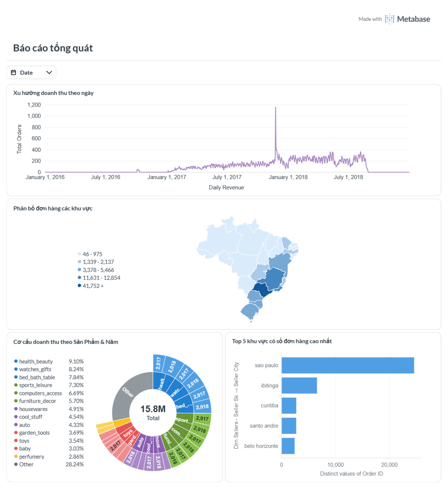

# ecommerce-de-pipeline-vuongdq


 


Pipeline ELT phân tích dữ liệu thương mại điện tử Olist. Dự án sử dụng **dlt** để trích xuất dữ liệu từ PostgreSQL, staging dữ liệu trên Amazon S3 và nạp vào **Amazon Redshift**; sau đó **dbt Core** cùng `dbt-redshift` chuẩn hóa, mô hình hóa và kiểm thử dữ liệu ngay trong warehouse.

Luồng chính được thiết kế để có thể chạy độc lập từ command line. Dự án cũng có DAG Airflow cho điều phối định kỳ và script hỗ trợ nạp bộ dữ liệu CSV vào PostgreSQL.
<p align="center">
  
</p>

## Dashboard with MetaBase
<p align="center">
  
  
</p>

## Kiến trúc

```text
Nguồn dữ liệu Olist (Kaggle / CSV)
                 │
                 ├── (tùy chọn) scripts/load_olist_csv.py
                 │                          │
                 │                          ▼
                 │                     PostgreSQL
                 │                          │
                 └──────────────────────────┤
                                            ▼
                                  dlt (Extract & Load)
                                            │
                                  Parquet trên Amazon S3
                                      (staging)
                                            │
                                            ▼
                                COPY / load vào Redshift
                                            ▼
                              Redshift: raw_olist
                                            │
                                dbt Core + dbt-redshift
                                            ▼
                       staging → intermediate → marts/reports
```

Trong luồng dlt hiện tại, PostgreSQL là nguồn dữ liệu, S3 là staging trung gian và `raw_olist` là schema dữ liệu thô trên Redshift. dbt tạo các lớp staging và intermediate dưới dạng view; các mô hình marts được vật chất hóa thành table. DAG Airflow (`olist_ecommerce_dag`) chạy lần lượt ingestion, `dbt run` và `dbt test`.

## Cấu trúc dự án

```text
ecommerce-de-pipeline-vuongdq/
├── .dlt/                         # Cấu hình/secrets cục bộ của dlt nếu muốn quản lý env riêng cho dlt (không commit)
├── data/                         # Dữ liệu cục bộ, ví dụ bộ CSV Olist (không commit)
├── dbt_ecommerce/
│   ├── models/
│   │   ├── staging/              # Làm sạch, chuẩn hóa nguồn Olist
│   │   ├── intermediate/         # Mô hình trung gian,Join,tính toán.
│   │   └── marts/                # Dimension, fact và báo cáo
│   ├── macros/                    # Macro dbt dùng chung
│   ├── dbt_project.yml
│   └── profiles.yml              # Profile dbt cục bộ (không commit)
├── ingestion/
│   └── pipeline.py               # PostgreSQL → S3 staging → Redshift bằng dlt
├── scripts/
│   └── load_olist_csv.py         # Nạp CSV vào PostgreSQL
├── airflow-local/
│   └── dags/olist_pipeline_dag.py
├── docker/                       # Cấu hình Docker Compose
├── infra/                        # Terraform cho hạ tầng AWS
├── .env.example                  # Mẫu biến môi trường
├── pyproject.toml
└── uv.lock
```

## Yêu cầu hệ thống

- Python **3.13 trở lên**.
- [`uv`](https://docs.astral.sh/uv/) để quản lý Python và dependencies.
- Tài khoản/quyền truy cập AWS phù hợp với S3 và Amazon Redshift.

## Cài đặt

### 1. Clone repository

Thay `<repository-url>` bằng URL Git thực tế của repository:

```bash
git clone https://github.com/vuowng204/ecommerce-de-pipeline-vuongdq.git
cd ecommerce-de-pipeline-vuongdq
```

### 2. Cài đặt Python dependencies

```bash
uv python install 3.13
uv sync
uv sync --group transform
```

`uv sync` cài dependencies chính và nhóm phát triển mặc định. `uv sync --group transform` bổ sung `dbt-redshift` để chạy các model dbt.

### 3. Cấu hình biến môi trường

Tạo `.env` từ mẫu và điền thông tin của môi trường riêng. Không commit `.env`, thông tin xác thực AWS/Redshift hoặc dữ liệu thực vào Git.

```bash
cp .env.example .env
```

### 4. Cấu hình profile dbt

`dbt_ecommerce/dbt_project.yml` sử dụng profile tên `dbt_ecommerce`. Tạo file `dbt_ecommerce/profiles.yml` (file này bị loại khỏi Git) với thông tin Redshift của bạn. Ví dụ:

```yaml
dbt_ecommerce:
  outputs:
    dev:
      type: redshift
      method: iam
      host: "{{ env_var('REDSHIFT_HOST', 'your-redshift-endpoint.amazonaws.com') }}"
      port: 5439
      dbname: "{{ env_var('REDSHIFT_DBNAME', 'dev') }}"
      user: "{{ env_var('REDSHIFT_USER', 'admin') }}"
      schema: "{{ env_var('REDSHIFT_SCHEMA', 'raw_olist') }}"
      threads: 4
      query_group: "dbt_dev"
      region: "{{ env_var('AWS_DEFAULT_REGION', 'ap-southeast-1') }}"  
 target: dev
```

Thêm `REDSHIFT_HOST`, `REDSHIFT_USER`, `AWS_DEFAULT_REGION`, `REDSHIFT_DBNAME` và `REDSHIFT_SCHEMA` vào `.env` (hoặc cấu hình trực tiếp qua môi trường chạy). Thay đổi `port`, `threads` và `ra3_node` nếu cấu hình Redshift của bạn yêu cầu. dbt không tự đọc `.env`; khi dùng shell, nạp các biến trước khi chạy:

```bash
set -a
source .env
set +a
```

## Vận hành pipeline

### Bắt đầu Container
  Từ thư mục gốc dự án, khởi động PostgreSQL trước để tạo Docker network và CSDL Postgres cùng Pgadmin:
   ```bash
   make up
   ```
  Muốn dừng các dịch vụ này dùng:
   ```bash
   make down
   ```
### Nạp CSV Olist vào PostgreSQL (tùy chọn)

Đặt các CSV đã tải từ Kaggle vào `data/olist/`, cấu hình các biến `POSTGRES_HOST`, `POSTGRES_PORT`, `POSTGRES_USER`, `POSTGRES_PASSWORD` và `POSTGRES_DB` trong `.env`, sau đó chạy:

```bash
uv run python scripts/load_olist_csv.py --data-dir data/olist
```
Hoặc 
```bash
make load-olist
```
Script nạp CSV vào các bảng PostgreSQL theo thứ tự đã định nghĩa. Đây là bước chuẩn bị nguồn dữ liệu; ingestion chính được thực hiện riêng bằng `ingestion.pipeline`.
### Chạy ingestion bằng dlt

Từ thư mục gốc repository, sau khi đã cấu hình `.env`, S3 và Redshift:

```bash
make ingest
```

Pipeline đọc danh sách bảng Olist từ PostgreSQL, ghi dữ liệu dạng Parquet qua S3 staging rồi nạp vào schema `raw_olist` trên Redshift. **Lưu ý:** cấu hình hiện tại dùng `write_disposition="replace"`; mỗi lần chạy sẽ thay thế dữ liệu các bảng đích tương ứng. Kiểm tra cấu hình và dữ liệu trước khi chạy trên môi trường dùng chung.

### Chạy dbt


Từ thư mục gốc repository, sau khi đã nạp biến môi trường:

```bash
uv run --group transform -- dbt debug --project-dir dbt_ecommerce --profiles-dir dbt_ecommerce
uv run --group transform -- dbt run --project-dir dbt_ecommerce --profiles-dir dbt_ecommerce
uv run --group transform -- dbt test --project-dir dbt_ecommerce --profiles-dir dbt_ecommerce
```

`dbt debug` kiểm tra kết nối và cấu hình trước khi chạy model. `dbt run` xây dựng các mô hình; `dbt test` thực thi các kiểm thử khai báo trong dự án. Hoặc chạy trực tiếp từ thư mục dbt:

```bash
cd dbt_ecommerce
uv run --group transform -- dbt run --profiles-dir .
uv run --group transform -- dbt test --profiles-dir .
```
### Điều phối pipeline bằng Apache Airflow

Airflow chạy bằng Docker Compose trong `airflow-local/`. Cần cài Docker Engine và Docker Compose, đồng thời cấp tài nguyên Docker phù hợp (khuyến nghị tối thiểu 4 GB RAM và 2 CPU cho stack Airflow).

1. Hoàn tất `.env` và `.dlt/secrets.toml` như hướng dẫn ở trên. Tạo `FERNET_KEY` hợp lệ (không dùng nguyên placeholder trong `.env.example`) bằng lệnh:

   ```bash
   python3 -c 'import base64, secrets; print(base64.urlsafe_b64encode(secrets.token_bytes(32)).decode())'
   ```

   Chép giá trị được in ra vào `FERNET_KEY` trong `.env`. Với kết nối PostgreSQL từ container Airflow dùng hostname `ecommerce-postgres` trong `POSTGRES_CONNECTION_STRING`; đây là tên container PostgreSQL trên Docker network dùng chung. `dbt_ecommerce/profiles.yml` phải có cấu hình Redshift hợp lệ .

2. Khởi động Airflow(Đảm bảo netwwork ecommerce-net đã được tạo từ bước trên):

   ```bash
   make flowu
   ```

   Lần đầu chạy, Docker sẽ build image Airflow với dependencies khai báo trong `airflow-local/requirements.txt`; quá trình này có thể mất vài phút. Theo dõi trạng thái và log khi cần:

   ```bash
   cd airflow-local
   docker compose ps
   docker compose logs -f airflow-apiserver airflow-scheduler airflow-worker
   ```

3. Mở giao diện tại [http://localhost:8081](http://localhost:8081), đăng nhập bằng `airflow` / `airflow` theo mặc định của Compose dành cho môi trường local. Đổi thông tin mặc định trước khi dùng ở môi trường chia sẻ. DAG `olist_ecommerce_elt` được tạo ở trạng thái paused; unpause DAG trong giao diện rồi trigger thủ công để chạy ngay. DAG cũng có lịch `@daily` và không chạy bù các khoảng thời gian trước đó.

   Thứ tự task là `clean_dlt_state` → `ingest_postgres_to_redshift` → `dbt_run` → `dbt_test`. Xem log từng task trong DAG Run trên giao diện Airflow. Ingestion hiện thay thế dữ liệu bảng đích khi chạy.

5. Dừng các dịch vụ Airflow khi hoàn tất:

   ```bash
   make flowd
   ```

   Lệnh này chỉ dừng stack Airflow; PostgreSQL vẫn chạy cho tới khi dừng riêng bằng `make down`.


## Công nghệ sử dụng

| Nhóm | Công nghệ |
|---|---|
| Quản lý môi trường và dependencies | `uv` |
| Ingestion / staging | `dlt`, PostgreSQL, Amazon S3, Parquet |
| Data warehouse | Amazon Redshift |
| Transformation / data tests | dbt Core, `dbt-redshift` |
| Data processing và kết nối | Pandas, PyArrow, Psycopg2 |
| Dataset / công cụ hỗ trợ | Kaggle, Pgcli |
| Điều phối / hạ tầng | Apache Airflow, Docker Compose, Terraform |

## Tác giả & liên hệ

**vuowng204** · [vuong8g@gmail.com](mailto:vuong8g@gmail.com)
